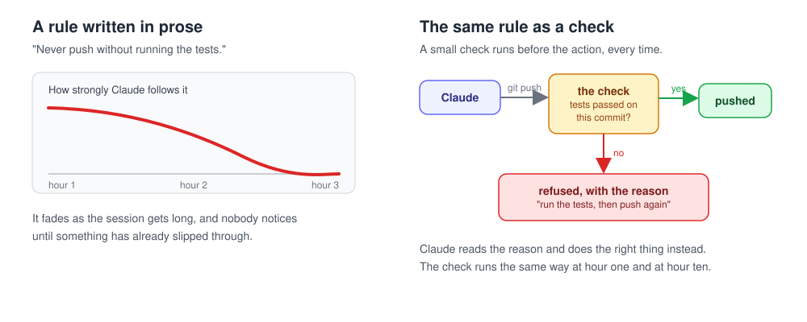
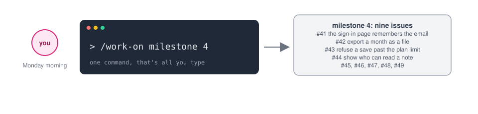
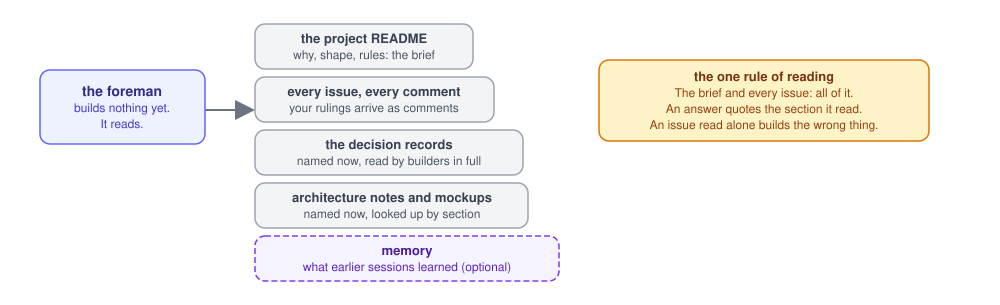
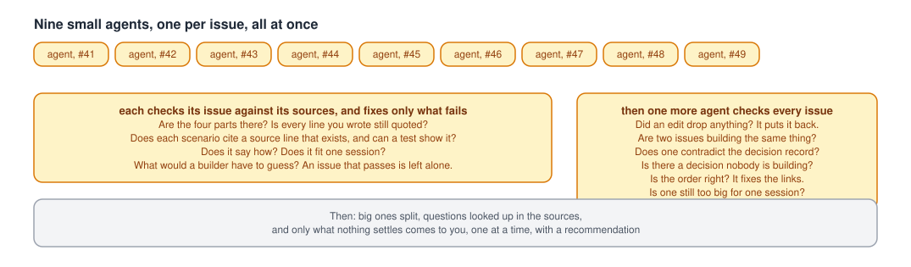
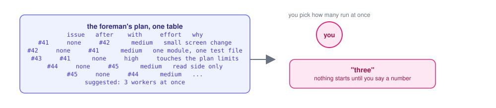
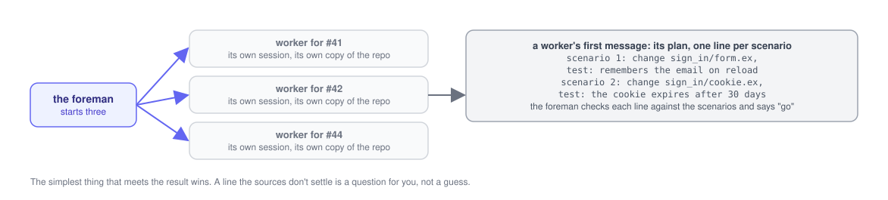
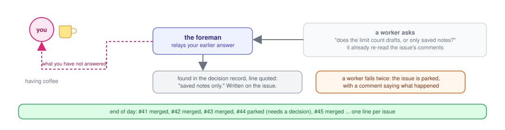
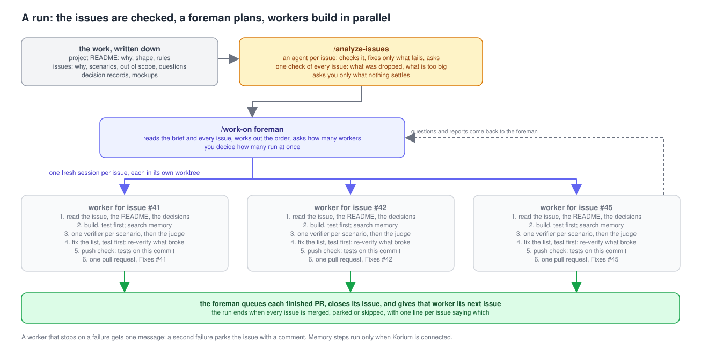
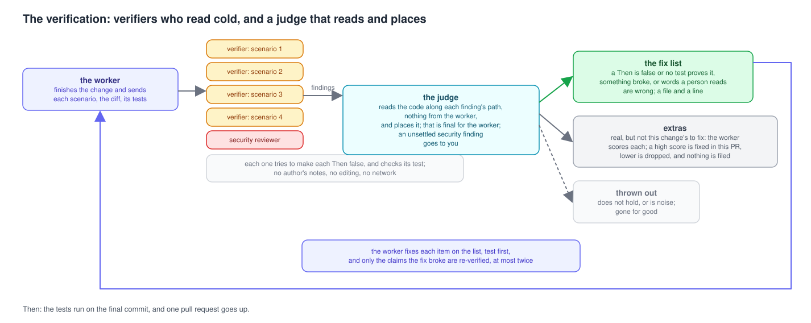

# Masthead

Masthead is a plugin for [Claude Code](https://code.claude.com). You give it
a list of things to build, as GitHub or Linear issues, and it builds them: each one in
its own session, checked, reviewed by people who weren't in the room, tested
on the exact commit that ships, and merged. You decide the things only you
can decide.

## What's new in 0.4.0

An optional new way to ship: agents land tested changes on one shared
`landing` branch, with no pull request per change.

- CI tests everything waiting there in one run. Green moves `main` forward.
- A red batch: Masthead finds the change that broke it and hands it back to
  the agent that wrote it, which fixes it on top. Nothing is taken out, and
  `main` waits until a later run is green.
- The agent's record of what it did goes on the issue, not in a pull request.
- A change to CI files (`.github/`, `scripts/ci/`) is stopped before it is
  pushed unless you have OKed it on the issue.

It's opt-in. Without it, Masthead works as before, pull requests and all.
Setup walks you through it click by click: [The optional batch
run](#the-optional-batch-run).

## Why we built it

We'd had the rules written down for a long time. "Search memory before you
change anything" sat in the file Claude reads at the start of every session.
Then we took out the small script that was enforcing it, and within two days
a whole piece of work shipped with nothing saved. Nobody noticed until later.
A rule in prose is a suggestion. A rule in front of the action is a rule.
That's the idea under all of it: write the spec into the issue before the
session starts, let the session run on its own, and put the rules that
matter where they can't be forgotten.



Here's what a day with it looks like.

## A day with Masthead

It's Monday. You have a milestone with nine issues in it, the kind of list
that used to mean a week of watching over someone's shoulder. You open
Claude Code in the repository and type one thing:

```
/work-on milestone 4
```



A foreman wakes up. It doesn't build anything yet. It reads. What earlier sessions
wrote down in memory first. Then the project's README, because that's the
brief: why this work exists, what shape it has, what rules it follows. Then
every issue, with every comment, because your rulings tend to arrive as
comments. It notes which decision record, architecture notes and
mockups the issues point at, but it doesn't read those end to end yet. Every
builder reads them in full, and when a builder asks a question, the foreman
reads the section the answer sits in and quotes it. A foreman that reads
everything up front runs out of room before the first builder starts.



Then it sends a small agent to every issue, all nine at once. Each one reads
its issue and checks it against its sources, on a fixed list. Are the four
parts there, in order? Is every line you wrote still quoted under the
scenario it rules on? Does each scenario cite a source line that exists, one
the agent opens and quotes: a decision that was made, a rule in the README,
something you actually said? Can a test show it, "Given this, When that,
Then this is true"? Does it say what has to be true when it's done, or does
it tell the builder how to do its job? Does it fit one worker session? Is each
ruling of yours on its area quoted with where you said it? Where the project
has an architecture doc, three more: does the issue quote the ADR's alignment
lines it builds toward, does it have a scenario for each build the ADR names that its work reaches, or that build named in Out of scope, and does a
pattern it says to copy keep to that shape? An
issue that passes is left alone: no edit, no comment. One that fails gets
only the failing part fixed, on GitHub, and a check in front of the edit
refuses a body that drops a line quoted as yours (three or more words in
quotes, with your name on the line or on a heading above it), or that adds a
question for you without saying where it looked first. Each agent hands the foreman only its
verdicts and the open questions. When all nine are done, one more agent, on
a stronger model, reads every issue against the decision record, the
architecture notes, the mockups and the old body. It puts back anything an
edit dropped and fixes the order, each fix resting on a line it can quote.
It tells you, without changing anything, when two issues build the same
thing, one contradicts the decision record, a decision has nobody building
it, or an issue is still too big for one session.



The big ones get split into sub-issues by the agent that checked them. Every
open question gets looked up in the sources first, in order: the issue's own
comments, the README, the decision record, the architecture doc, the
mockups, the memory. Whatever a source settles is written into the issue
with the line quoted, so nobody has to ask twice. Whatever nothing settles
comes to you, one question at a time, with a recommendation. You answer in a
sentence. It goes on the issue in your words. An issue with a question still
open stays out of the run until you've answered it.

Now the foreman tells you, in one sentence, what it is about to do, and asks
how many workers. You pick a number. Say three. It names the three issues
that fill those slots, each with what the customer gets, and brings you the
questions those issues still carry, one at a time, in plain words. You answer;
each answer goes onto the issue in your words. Then it tells you how far the
queue of issues with no open question runs behind them, and takes the next
questions whenever you want, so the run never waits on one. The order, the
effort each worker runs at and what can run side by side are its calls, and
it does not hand you a table to judge them by.



Three fresh sessions start, each with its own copy of the repository and a
branch tied to its issue. Each worker reads its issue, the README and the
decision record cover to cover, looks up what earlier sessions learned, and
builds. It writes no plan and waits for no go: the design was reviewed
before the issues were written, the verifier checks each scenario once
the code exists, and the architecture reviewer checks the code against the
design. Where a mockup page has become a template in the app, the
worker starts that screen from the template and keeps its words and layout.
A worker is done when every scenario has a test that passes, the screens the
issue touches work, the push check passes and the pull request is open. In a
repository that chose the optional batch run, it instead lands its commits on
the `landing` branch and posts the change's record on the issue, and no pull
request is opened. Then it stops.



Then they build. A bug is fixed test first: a failing test in its own
commit, then the fix. Anything a worker notices that the issue didn't ask
for is an extra. It scores each one, fixes in the same change the ones
that score high enough, and drops the rest without filing them; the rule is
in `skills/work-on/worker.md`.

When a worker thinks it's done, it doesn't grade its own work. For each
scenario it sends one verifier the scenario, the decision lines it rests on,
the README's opening paragraph on who uses the product, the mockup page the
scenario rests on, the diff, the test that proves the scenario, and the
list of what it could not prove. Nothing else: not its notes, not
an earlier review. The verifier answers two questions. Is each Then true in
every state production can reach, and does a test really prove it, so that
it would fail if the behavior were missing, and pass? And, for a bug fix,
was the test written first, and did it fail before the fix? For the first
question it assumes the code is wrong and tries to prove it, with every way
the scenario's own claims go wrong as its methods: a write that fails
halfway, an input nobody handled, a promise to a caller the code breaks, a
shared module written again, a sentence a customer reads that is false in
some state. It tries only states production can reach, starting from a real
entry point such as a route, a job or a webhook. For every claim it returns
either "true in every state", with the run that shows it, or each state
where it is false, with the run; never partly.
It is not a general review of the code: when it notices something outside
the scenario that looks like a real fault a customer could hit, it writes
one line for the judge, with the file and line, and moves on. A security
reviewer joins
when the change touches sign-in, secrets or input from outside, with the
repository's security rules as its claims. One architecture reviewer joins
every change, once: it holds the lines the change touched to the decision
record, the project's architecture doc and its principles, through seven
lenses (which way the names point, one way in and out of each body of data,
the shape of the calls, real seams, what each build carries, leftovers, and
tests that prove nothing), checks that what the decision record asks is
built and matches the mockups, and scores each finding for the customer and
for drift from the doc's seven rules. None of them can edit files with
Claude's editing tools. The architecture reviewer's shell runs only
`git diff`, `git show` and `git log` with plain revisions and paths, the
plugin's `project_fact.py` to ask for the tracker or the architecture doc,
and `gh issue view` to read its issue, and refuses every other command. The
verifier's and security reviewer's shells run only the command shapes in
`hooks/reviewer_shapes.py`: read-only git, the repository's own tests with
their offline switches, semgrep and opengrep with their calls home turned
off, a few reading tools such as cat, grep and jq, and rm of the agent's own
scratch files, one command at a time or several joined by |, &&, || or ;.
They refuse every other command, a wrapper such as `timeout 5 curl`
included, and every redirect into a file. The fence covers the commands the
agent types, not code it runs: a test, a test runner, semgrep, or a probe
script it wrote itself in its scratch folder can still do anything (MAST-43). Then a judge, given the same product
context and nothing from the worker, reads the code along each verifier's
path without running the tests a third time, and places each finding that
holds: fixed in this change when a scenario's Then is false or no
test proves it, a bug's test did not come first, something
that worked before broke, or words a person reads are now wrong; otherwise
an extra, which the worker scores like its own. Once the trial is off, an
architecture finding that breaks one of the doc's seven rules, a line of the
decision record or the principles, or a build the doc names goes on the fix
list whatever its customer score. One where the decision record and a
mockup disagree always comes to you. That placement is final for the worker and the foreman; nobody files
anything. The worker fixes the list, test first again, and only the claims
the fix broke go back to a verifier, and only the architecture findings it
fixed to the architecture reviewer, at most twice. The tests run on the final commit and leave a
receipt that names it, and nothing can be pushed until the receipt matches.
Then one pull request goes up, with `Fixes #41`, the list of what wasn't
proved, the number of agent dispatches it took, and the issue moves to In
Review. With the batch run, the worker instead rebases onto the `landing`
branch, runs the push check on that commit, and pushes it there, with no pull
request. A comment on the issue holds the change's record: what wasn't
proved, the extras it fixed with their scores, and the number of agent
dispatches it took, and the issue moves to In Review.

Meanwhile you're having coffee. A worker's question lands at the foreman,
which re-reads the issue's comments and Korium for an answer you already
gave and relays it with the line quoted. Anything you have not answered
reaches you one question at a time, in customer words, and your answer goes
back verbatim and onto the issue so the next session finds it. The foreman
decides how the work runs; what the product does, says or charges, and who
may do what, are yours. A worker that stops on a failure gets one
message; a second failure parks the issue with a comment saying what
happened, and the run goes on without it.



When a pull request is ready, or with the batch run a worker's commits land,
every extra its worker's rule says to fix is already fixed in it, and nothing else reaches you unless a security finding
could not be settled or the decision record and a mockup disagree; that
comes one item at a time, and you answer it. While the architecture
reviewer is on trial, every one of its findings reaches you too, kept or
thrown out, with its lens, smell, class, scores and the judge's placement,
and the worker fixes only the ones you send back. The trial is on from the
first run until you set `"ARCHITECTURE_TRIAL": "off"` in the env block of
`.claude/settings.json`. No issue is ever filed from a review. When its checks pass, its review
is clean, every line is answered and the worker has cleaned up after itself,
the foreman queues it to be merged. It closes the issue, and any big issue
whose pieces are now all done, then starts the next issue, one that waited on
this one first, in that worker in the desktop app or in a
fresh session in the terminal. By the end of the day every issue is merged,
parked or skipped, and you get one line per issue saying which, with how
many merged.

With the batch run, the foreman instead accepts the landing and starts the
next issue in that worker. Main moves forward only from `landing`: once a
batch of landed commits is in, one run of the repo's Gate tests it, and when
a green batch moves main, the foreman closes each issue it carried, and any
big issue whose pieces are now all done, and starts the issues that waited on
them. Every session reads which way the repository ships from one fact,
`project_fact.py --ships`, which says `batch` only once setup's two batch
files are committed on `landing`.



The whole time, a set of small checks runs underneath. Nobody, not a worker,
not a verifier, not Claude in a hurry, reads a secret, force-pushes, pushes
untested code, or sends a verifier a brief with no claims to check. You
don't see those checks unless one says no, and when it does, it says why and
what to do instead.



### One issue on its own

`/work-on #123` does the same for a single issue with you as the foreman.
The worker tells you in a few lines what it will build and waits for your
go. In a repository whose issues live in Linear, name the issue by its key:
`/work-on KOR-12`.

### Moving issues between GitHub and Linear

`/masthead:migrate-issues` moves a set of issues from GitHub to Linear, or
from Linear back to GitHub, such as
`/masthead:migrate-issues linear "Website relaunch" to github acme/site`. It
reads first and shows you what each project, milestone and issue becomes on
the other side, and what happens to the originals at the end, and writes
nothing until you say yes. A project stays a project and a milestone stays a
milestone. Each issue keeps its title, text, labels, every comment (each
naming who wrote it and when) and its sub-issue and blocked-by links. A
GitHub issue labelled `needs-decision` or `parked` lands in Linear as Needs
Human, and a Needs Human issue lands on GitHub with the `needs-decision`
label. Linear to GitHub also keeps the status when it is Backlog, Todo, In
Progress or In Review, and names each issue whose status it left empty. A last step counts the issues and comments on
both sides, then closes each original on GitHub as not planned, or cancels it
in Linear, once its copy matches. Nothing is deleted. Run any step again and
nothing is copied twice. Linear is reached with an API key read when the step
runs and never shown.

## Install

Open Claude Code in a repository and run these two inside the session,
not in a terminal, because only the in-session install asks you the four
install options (a terminal install takes the defaults silently):

```
/plugin marketplace add kyroco/masthead
/plugin install masthead@masthead
```

It asks whether to connect Korium memory (off unless you say so), whether to
keep a code index in Korium (off), whether to keep AI attribution out of commits (on), and whether a helper needs a reason
before running on the biggest model (off). Then run `/masthead:setup`. It
asks four questions about the repository, or three when a memory is already
connected, and one or two more when it finds a folder of decision records or
no ignore line for its working files, one about the architecture doc (it names the one it finds, or offers to draft one from the code), and one about the Gate (it works out which workflow runs your checks and stores it in `.claude/gate.json` after one yes, for the optional batch run; with no Gate or no yes, the repository ships the way it does today), and writes nothing until you say yes: just you or the team
(whether the settings are committed with the code), tests before a push
(it finds your test command), whether its issues live in GitHub or Linear
(one at a time, never both), and whether to connect a memory now, later or
not at all. Run it again whenever you want to change an answer.

With an architecture doc recorded and code to check, setup then offers to
check the code you already have against it, since the pull request reviewer only sees the lines
a change touches: a targeted review of the parts you name, a full sweep, or
neither. The same architecture reviewer reads the code, three to a batch,
and a judge reads the code at each finding, keeps what drifts from the doc,
is broken today or breaks a build the doc names, and groups what is left by
cause. You see one row per cause and choose which become issues; nothing is
filed unless you say so. A sweep too big for one session stops, says what it
did not review, and the next `/masthead:setup` goes on from there.

### The optional batch run

With a Gate stored, setup asks whether to put the batch run into the
repository, unless it is already there, the Gate cannot be started the way
the batch run starts it, or the repository is on a personal account, which
the App steps below do not cover. Say no and nothing changes: the repository
ships the way it does today. Say yes and work lands on a branch named
`landing`, one Gate run tests each batch, and main moves to the batch only
when that run is green. On one more yes, setup then writes a small starter
file, `.github/workflows/masthead-batch.yml`, which calls the batch run kept
in this repository; makes the `landing` branch from main if it is missing;
and makes an environment named `masthead-batch` that only `landing` may use,
to hold the App's two secrets. Once you have stored the secrets and the
starter file is on `landing`, setup locks main, on a yes of its own, with a
ruleset whose only bypass is your batch App, so no person, session or pull
request merge can push main again. It will not lock main before then, since
nothing could move it. `batch.py check` (setup runs it) says which parts are
in place. Rulesets and environments on a private repository need a paid
GitHub plan.

The batch run moves main as a GitHub App you own, because a ruleset lets
nothing else through. Registering it takes a person, once per organization,
and storing its key takes a person too: Masthead refuses every session's
`gh secret set`. The steps follow, and setup shows them with your repository
filled in.

### Set up the batch run's GitHub App

You need to be an owner of the organization that owns the repository. Each
button below is named as GitHub shows it.

Register the App:

1. On GitHub, click your profile picture in the upper-right corner, click
   **Your organizations**, then click **Settings** to the right of the
   organization.
2. In the left sidebar, near the bottom, click **Developer settings**, then
   **GitHub Apps**.
3. Click **New GitHub App**.
4. Under **GitHub App name**, type a name of 34 characters or fewer that no
   one on GitHub uses yet, such as `acme-batch`.
5. Under **Homepage URL**, paste any address of yours, such as the
   organization's website. GitHub only needs a link.
6. Under **Webhook**, untick **Active**. The App needs no events.
7. Under **Permissions**, open **Repository permissions**. Set **Contents** to
   **Read and write** and **Workflows** to **Read and write**. Leave the rest
   at **No access**; GitHub sets Metadata to read-only by itself. Workflows is
   needed because a batch can carry a change to a workflow file, and GitHub
   refuses such a push without it.
8. Under **Where can this GitHub App be installed?**, choose
   **Only on this account**.
9. Click **Create GitHub App**.

Copy the App ID:

10. The App's page opens. Near the top, under **About**, copy the number next
    to **App ID**, such as `5832645`. It is not a secret; setup asks you for
    it. The Client ID beside it is a different thing; do not use it.

Make the private key:

11. On the same page, in the left sidebar, click **Credentials**, then
    **Key pairs**, then **New key**. If you left the page, go back to
    **Developer settings**, **GitHub Apps**, and click **Edit** next to the
    App first. On older GitHub pages the button is **Generate a private key**,
    under **Private keys** at the bottom of the App's page.
12. Your browser saves a file ending in `.private-key.pem` to your Downloads
    folder. It downloads once, when the key is made, and GitHub keeps no copy,
    so move it somewhere safe outside every repository. The install below does
    not ask for it. If you lose it, make a new key the same way; the App can
    hold several at once. Store the new key in every repository that uses the
    App before you delete the old key under **Key pairs**: each of those
    repositories still moves main with the old one until then. To see which
    repositories use it, open the App's **Configure** page (steps 15 to 17
    below) and read the list under **Repository access**. Run the second
    command below once for each of them, with its name after `--repo`.

Install the App:

13. In the App's left sidebar, click **Install App**, then click **Install**
    next to your organization.
14. Choose **Only select repositories** and pick this repository from the
    **Select repositories** list. Click **Install**. Install it only on the
    repositories that chose the batch run: the App can move main in every
    repository it is installed on.

Add this repository to an App you already have:

One batch App serves the whole organization. For each further repository that
chooses the batch run, skip the steps above and do these instead, then store
the two secrets below in that repository too, with the same App ID and the
same `.pem` file. If no one has the `.pem` file any more, make a new key as
step 11 says and follow step 12: the new key goes into every repository that
uses the App before you delete the old one.

15. Click your profile picture, click **Your organizations**, then click
    **Settings** to the right of the organization.
16. In the left sidebar, under **Third-party Access**, click **GitHub Apps**.
17. Next to the batch App, click **Configure**.
18. Under **Repository access**, keep **Only select repositories**, open the
    **Select repositories** list, and add this repository. Click **Save**.

Store the two secrets, after setup has made the `masthead-batch` environment.
Run these in a terminal, with your App ID and the path to your `.pem` file:

```
gh secret set BATCH_APP_ID --env masthead-batch --repo OWNER/REPO --body 5832645
gh secret set BATCH_APP_PRIVATE_KEY --env masthead-batch --repo OWNER/REPO < ~/keys/acme-batch.private-key.pem
```

Keep the two only on the environment. As a repository or organization secret
the key would reach every workflow on every branch, the Gate included, and
any of them could move main with it. Once the secrets are in and the starter
file is on `landing`, tell setup, and it locks main.

### Make your Gate ready for a batch run

Do this before the first batch, so the first batch is not where you find out.
In a batch run your Gate's code is the same, but GitHub tells it different
things: the starter calls it as a job on a push to `landing`. Kyroco's first
batch run went green only after its Gate changed in the three ways below.
Setup runs `gate.py snags` and shows you each line of your Gate that needs
one of them; you can run it yourself the same way:

```
python3 ~/.claude/plugins/cache/masthead/masthead/<version>/skills/setup/gate.py snags --root .
```

It reads the Gate stored in `.claude/gate.json`, each workflow the Gate runs
with `uses: ./...`, and each `workflow_run` workflow that names it. It does
not read scripts. Masthead changes none of these files: they are yours.

1. Find every test for `workflow_dispatch` in your Gate and in the scripts it
   runs, such as a step that picks which machine runs a job, or one that
   decides whether plan checks run. A batch run is not a `workflow_dispatch`
   run: its event is `push`, its ref is `refs/heads/landing`, and
   `github.workflow_ref` names `masthead-batch.yml`, not your Gate.
2. Beside each one, add a test that matches a batch run on all three of
   those. Kyroco's reads:

   ```yaml
   || (github.event_name == 'push' && github.ref == 'refs/heads/landing'
   && endsWith(github.workflow_ref, '/.github/workflows/masthead-batch.yml@refs/heads/landing'))
   ```

   In a shell script, Kyroco passes the three in as `GATE_EVENT_NAME`,
   `GATE_REF` and `GATE_WORKFLOW_REF` and checks that the workflow ref ends in
   `/.github/workflows/masthead-batch.yml@refs/heads/landing`.
3. Find every use of `github.event.before`. In a batch run it is only the
   commit before the last push, so a diff from it misses every other commit in
   the batch. For a batch run, diff against main instead, the way a run you
   start by hand does.
4. Find every place that looks up one of your Gate's checks by name. In a
   batch run each check is named `gate / <job>`: the starter's job is named
   `gate`, and your Gate's own job name follows it. Kyroco's verdict job is
   named `gate`, so its check is `gate / gate`; a job named `test` would give
   `gate / test`. Look for both names, the old and the new.
5. Find every `workflow_run` workflow that lists your Gate by name, such as
   `workflows: [Gate]`. A batch run is named `Masthead batch`, so add it:
   `workflows: [Gate, Masthead batch]`.
6. Commit the changes, with your own OK for a change to `.github/`, and run
   `gate.py snags` again. It answers `"clear"` when none of the three is
   left in the files it reads.

### Install options

To change an install option later, run `/plugin configure masthead@masthead`:

| Option | Default | What it does |
|---|---|---|
| Connect Korium memory | off | Each session looks up what earlier sessions learned before its first change, and saves what it learned at the end. Needs a [Korium](https://kyroco.ai) account; there's a free plan. Everything else works without it. |
| Keep a code index in Korium | off | Only with Korium memory on and korium-cli installed. The names and structure of the code in each repository you open, and the names you search for, go to your Korium account, so Claude can ask the index before it greps. Leave it off for a repository you may not send to Korium. |
| Keep AI attribution out of commits | on | Refuses a commit message or pull request body with an AI co-author line, a session link or a generated-with footer. |
| Ask for a reason before a helper runs on the biggest model | off | A helper sent to the big model, by the call or by inheriting this session's, runs there only when the brief says why; a call that names no model is not asked for a helper whose file in the project's or the plugin's agents folder names one, or for another plugin's helper. |

To remove it: `claude plugin uninstall masthead@masthead`. The settings file
setup wrote and the push check script (`.claude/push-check.sh`) are yours to
delete.

## What an issue has to say

An issue says what is true when the work is done, never how to get there,
in four parts: **Why** (what a person can't do today, with the file and line
when known), **Scenarios** (at least one line of "Given, When, Then", each
naming the decision, README rule or your own words it rests on), **Out of
scope** (what this issue leaves to another), and **Questions** (what the
sources don't settle, each marked `[NEEDS CLARIFICATION]`). One issue is one
pull request, or one landing with the batch run, built and proved by one worker in one session. The
`analyze-issues` skill checks each issue against this shape and its sources,
fixes only the part that fails, and splits the ones that are too big, so you
don't have to write them this way yourself.

## Every check, what it refuses, and where it falls short

Each check is a short script under `hooks/`, run by Claude Code at a fixed
moment: before a tool call, after one, or when a session or helper stops. It
reads what is about to happen and either lets it through or refuses it with a
reason Claude can act on.

### Always on

| Check | Runs | Refuses | Where it falls short |
|---|---|---|---|
| `block-secret-reads.py` | before a Read, Grep or shell command | reading a credential file: `.env`, keys, tokens, password files, cloud and SSH credentials, even through the masked reader | matches file names and command text, so a secret in an oddly named file isn't recognized; a 1Password reference passes inside `op run`, which hands the value only to the command and masks it in output, unless the same command also runs `op read`, `op inject`, `op item get` or `op document get` |
| `block-secret-fetches.py` | before a shell command | pulling a secret out of a vault or secret store on the command line | matches command text |
| `scan-tool-output-for-secrets.py` | after a shell command | nothing; warns when the output looks like a credential | a backstop after the fact |
| `issue-edit-gate.py` | before a shell command, a GitHub connector issue edit or a Linear `save_issue` | an issue edit whose new body drops a line quoted as yours (three or more words in quotes, with your name on the line or on a heading above it), or adds a `[NEEDS CLARIFICATION]` question with no `looked in:` part naming the decision record, the README rule and the Korium query searched | on the shell it reads the body from `--body-file <path>` only, a real file (not a link) inside the git checkout, with the edit alone in its own command, and refuses with that form to use `--body`, standard input, a heredoc, a here-string, a session folder that is no checkout, and anything around the edit (a wrapper such as `sudo` or `env`, `$(...)`, a shell keyword, a `cd`, another command); a connector edit with no `gh`, and every Linear edit of an issue's text, is checked against the issue as the session last read it, and refused when it has not read it; a Linear `patch` is applied to that copy first; knows you by the first name in git config, or "the user" when it is the one speaking; a document quote on the same line as your words is kept too; a question already on the issue is left alone; it guards against a line dropped by accident, like the other checks, and does not resist a session set on getting past it |
| `connector-commit-gate.py` | before a GitHub connector call | `push_files`, `create_or_update_file` and `delete_file`, which write a commit on GitHub that never passes the push gate's test check; work goes up with `git push` | another server's tool with the same name is refused too |
| `irreversible-action-gate.sh` | before a shell command | force pushes, hard resets, `git clean`, deleting a remote branch, skipping the checks with `--no-verify`, and destructive data and infrastructure commands | emits a refusal, not a question |
| `untrusted-domain-deny.py` | before a web fetch or search | requests to paste sites and other hosts code shouldn't reach | the host list is in the script |
| `web-to-memory-gate.py` | after a web fetch; before a write | copying text fetched from the web into files every session loads, or into memory, without a marker saying the web was read | files inside a git repository are left alone, since a pull request shows them |
| `agent-brief-gates.sh` | before a helper is sent | a brief to a verifier or security reviewer that leaves out the claims it must check; a third re-verify round; a brief to the architecture reviewer without the decision record's path, its alignment lines or the architecture doc's path | checks the shape of the brief, not whether it's true |
| `dispatch-record-gate.sh` | before a helper is sent | nothing; records which model each helper ran on, and whether it was a re-verify round | |
| `review-write-fence.py` | before a file write | a verifier or the architecture reviewer writing anything but its own findings file, or a scratch file under the review folder | a shell write isn't seen |
| `bash-scope-reviewer.sh` | before a shell command | a verifier or security reviewer running any command but the shapes in `reviewer_shapes.py` (read-only git, the repository's tests, semgrep and opengrep with their calls home off, a few reading tools, rm of its own scratch files); an architecture reviewer running a common network program (curl, ssh, gh and the like) or any command with a URL, though it may run `gh issue view <n>` for its issue | reads the command typed, not what a test or script it runs then does; with no jq, the verifier's and security reviewer's every command is refused |
| `bash-scope-diagnoser.sh` | before a shell command | the diagnoser or reader doing anything but running tests, reading git history and inspecting files; the architecture reviewer running anything but `git diff`, `git show` or `git log` with plain revisions and paths, `project_fact.py --tracker` or `--architecture-doc`, and `gh issue view <n>`, bare or with `--comments` | scoped by the agent's type |
| `verdict-gate.sh` | when a session or helper stops | a diagnosis case file whose verdict names no file and line, or has fewer than two numbered observations | |
| `scope-gate.py` | before and after a write | while a scope file exists in the checkout, writes outside its allowed paths; puts back a protected file a command changed | a background command's later writes aren't seen |
| `skill-review-gate.py` | before a skill or helper runs | invoking a changed project skill or agent nobody in the session has read | project files only |
| `prime-context.py` | at session start and on each prompt | nothing; injects the procedure that fits the prompt (before a commit, before a push, before reading a test result) | |

### Fully on once the repository states the fact setup writes

| Check | Runs | Refuses | Needs |
|---|---|---|---|
| `hard-gate.sh` | before `git push`, `gh pr create` or a GitHub connector's `create_pull_request`; the test receipt and the secret scan first, then the stack checks, which are skipped when this exact commit already passed them | a push that carries something shaped like a secret, a push of a commit that changes a file under `.github/` or `scripts/ci/` with no `CI-change-OK:` line pointing to the comment where the person said OK, or fails a changed stack's format, compile, lint or type check; with the test command, a push until the push check reports the tests passed on this exact commit, a push of any other commit, and a command line that changes the commit before it pushes (a rebase, commit or pull ahead of the push) | nothing for the secret scan and the stack checks; the test command from setup (`PROJECT_PUSH_CHECK`) for the test receipt |
| `adr-sections-gate.py`, `adr-structure-gate.sh`, `wiki-refresh.sh` | before a write; at stop; at session start | a decision record written without the sections in `hooks/adr_shape.py`, or an edit that drops one; with an architecture doc recorded, a new record that does not say how it applies the doc and which builds it must work in, and a pull request whose record diverges from the doc while leaving the doc unchanged; a finish that leaves one short of them or with an unchecked claims list; keeps the records folder fresh | the two gates only with a decision records folder named (`ADR_DIR`, which setup writes when you ask for the fixed shape), and nothing is held in a repository that named none; the refresh only with `ADR_DIR` set to an absolute path |
| `elixir-toolchain-env.sh`, `elixir-format-after-edit.sh` | at session start; after an edit | nothing; pins the Elixir toolchain and formats an edited file | an Elixir root (`PROJECT_ELIXIR_ROOT`) |

Where these three fall short, together: the fact names a file, and the copy
that runs is the one in the checkout you are in. A branch can change the push
check script or the toolchain file, the same way CI runs a pull request's own
tests. The record of which commit passed is a file in the checkout too. So the
push check is a guard against forgetting, not against intent; the guard
against intent is you, since a change to the checks themselves waits for your
OK.

The push gate also remembers that a commit passed its stack checks, in one
line in the checkout's git folder, so a second push of the same commit does
not wait for them again. The line holds for the same files,
the same base on main, the same gate script, the same pinned toolchain and the
same place on the path for the main tools the checks call, and
only while nothing is uncommitted or untracked and no file git ignores
(installed packages, build output) has been added, removed, or changed in size
or time stamp. Nothing is remembered in a checkout that holds a submodule, or
after a run that skipped a check because its tool was not installed. It does
not see a tool upgraded in place, or a change inside another worktree of the
repository kept in the checkout: that one is a checkout of its own, with its
own files and its own line.

### On or off with an install option

| Check | Option | Refuses |
|---|---|---|
| `engram-protocol.sh` | Connect Korium memory | the first edit before a memory search; a finish with nothing saved; a capture over 2,000 characters; a capture filed under another agent's name; a decision saved with no `decided_by` field, or with no word on what it replaces (it checks the field is there, not who it names) |
| `capture-finding-reminder.py` | Connect Korium memory | nothing; reminders only |
| `korium-index-on-stop.sh` and the code index gates in `engram-protocol.sh` | Keep a code index in Korium | a grep for a name the code index holds until the index is asked (and every grep while korium-cli is signed out or Korium does not answer), a search that repeats a name it just answered, and, once, a whole-file read of a file it just placed; the index refresh at the end of a session refuses nothing |
| `commit-attribution-gate.py` | Keep AI attribution out of commits | a commit message or pull request body with an AI co-author line, a session link or a generated-with footer |
| `model-choice-gate.sh` | Ask for a reason before a helper runs on the biggest model | a helper sent to the big model, by the call or by inheriting this session's, with no reason on the first line of its brief; a call that names no model is not asked for a helper whose file in the project's or the plugin's agents folder names one, or for another plugin's helper |

The off switches are environment variables read from the check's own
environment, so a session can't switch a check off for itself:
`MASTHEAD_CODE_GATE`, `MASTHEAD_SEARCH_GATE`, `MASTHEAD_CAPTURE_GATE`,
`MASTHEAD_MODEL_GATE`, `MASTHEAD_BRIEF_GATE`, `MASTHEAD_DONE_GATE` and
`MASTHEAD_INDEX_ON_STOP`, each set to `off`. A switch that a repository's
own committed settings file sets is ignored, so a clone can't turn a check off
for the sessions that open it.

## What Masthead never does

- Send anything anywhere. There's no telemetry. The only network use is the
  Korium memory, and only if you connect it; the code index is a second
  switch, off unless you turn it on.
- Change your code on its own. The checks refuse actions; they don't take
  them.
- Read a secret file, not even to check it.
- Touch your git history. No co-author trailers, no footers.

## For the curious

The skills under `skills/` are the written procedures Claude follows:
`work-on` (the foreman and the worker), `review-design` (the design checked
against the code and the mockups before issues are written, and, when you say
yes, the mockups turned into screens), `analyze-issues`
(the checks on each issue before a build), `github-issues` (how the tracker is used), `linear-issues` (the same for Linear), `migrate-issues` (moving a set of issues from GitHub to Linear or back), `setup`, and the two
Korium skills. `agents/` holds the verifier, the security reviewer, the architecture
reviewer, the judge (the `adjudicator` agent), the diagnoser and the reader. `references/` holds the pull request steps and the brief
format. `bash hooks/run-tests.sh` runs every check's tests, and CI runs them
on Linux and macOS.

Masthead is made by [Kyroco](https://kyroco.ai). It's the setup we run on our
own repositories every day. Apache 2.0.
