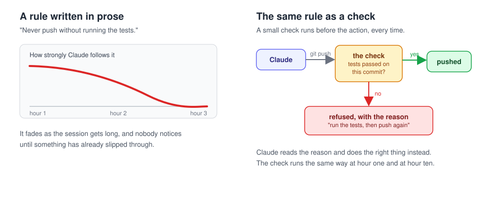
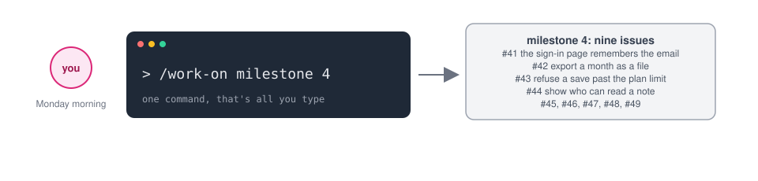
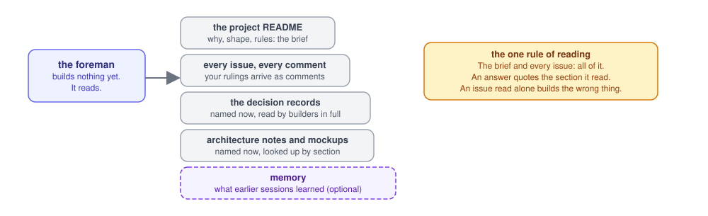
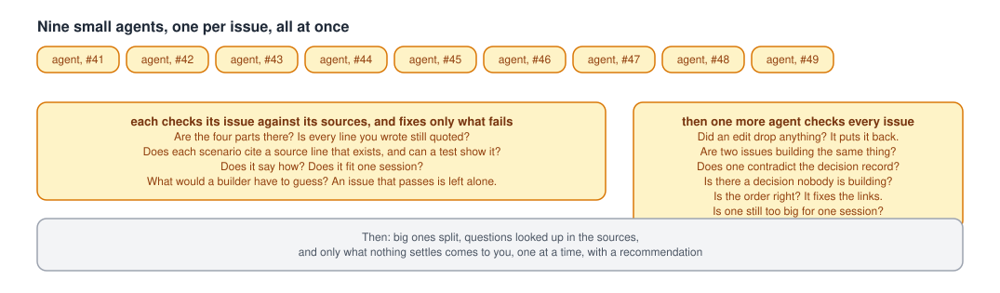
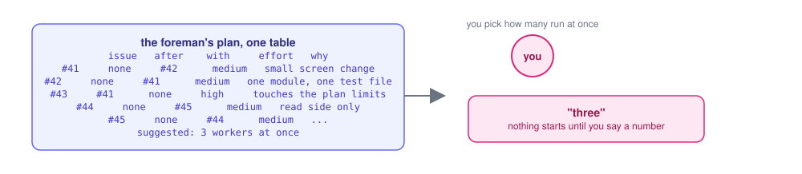
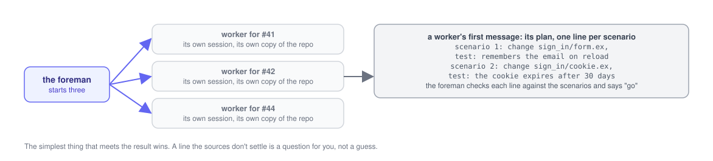
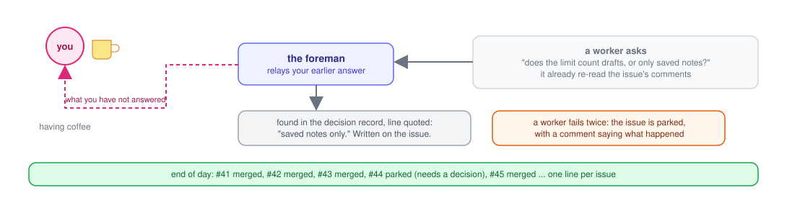
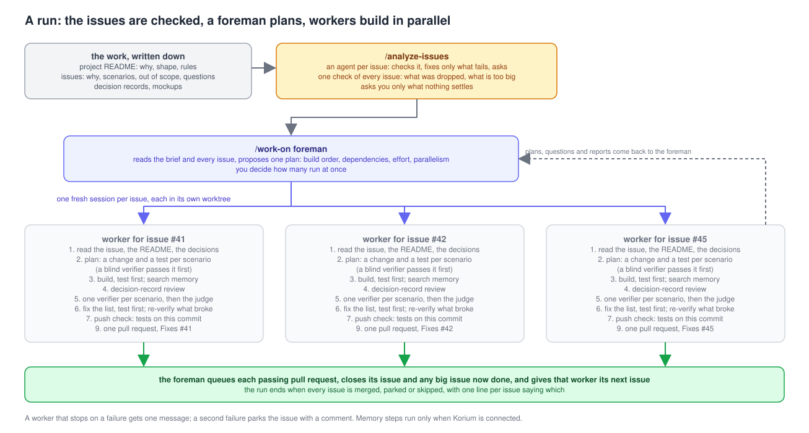
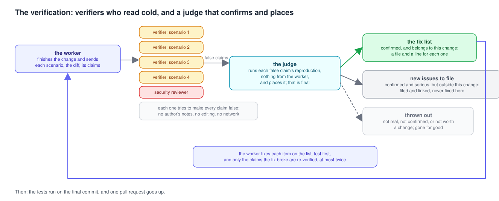

# Masthead

Masthead is a plugin for [Claude Code](https://code.claude.com). You give it
a list of things to build, as GitHub issues, and it builds them: each one in
its own session, checked, reviewed by people who weren't in the room, tested
on the exact commit that ships, and merged. You decide the things only you
can decide.

## Why we built it

We'd had the rules written down for a long time. "Search memory before you
change anything" sat in the file Claude reads at the start of every session.
Then we took out the small script that was enforcing it, and within two days
a whole piece of work shipped with nothing saved. Nobody noticed until later.
A rule in prose is a suggestion. A rule in front of the action is a rule.
That's the idea under all of it: write the spec into the issue before the
session starts, let the session run on its own, and put the rules that
matter where they can't be forgotten.



Here's what a day with it looks like.

## A day with Masthead

It's Monday. You have a milestone with nine issues in it, the kind of list
that used to mean a week of watching over someone's shoulder. You open
Claude Code in the repository and type one thing:

```
/work-on milestone 4
```



A foreman wakes up. It doesn't build anything yet. It reads. The project's
README first, because that's the brief: why this work exists, what shape it
has, what rules it follows. Then every issue, with every comment, because
your rulings tend to arrive as comments. Then the decision records the
issues point at, the architecture notes, the mockups, and what earlier
sessions wrote down in memory.



Then it sends a small reader to every issue, all nine at once. Each reader
comes back with the same report. Does this issue say what has to be true
when it's done, or does it tell the builder how to do its job? Can I read
scenarios out of it, "Given this, When that, Then this is true," and does
each one rest on something real: a decision that was made, a rule in the
README, something you actually said? Is it too big for one pull request?
What would a builder have to guess? One more reader looks at the milestone
as a whole: are two issues building the same thing, does one contradict the
decision record, is there a decision nobody is building, is the order right.



The foreman shows you the first issue rewritten, old body beside new, and
you say go. The rest get rewritten the same way. The big ones get split into
sub-issues. Every open question gets looked up in the sources, in order: the
issue's own comments, the README, the decision record, the architecture doc,
the mockups, the memory. Whatever a source settles is answered on the issue
with the line quoted, so nobody has to ask twice. Whatever nothing settles
comes to you, one question at a time, with a recommendation. You answer in a
sentence. It goes on the issue in your words. An issue with a question still
open stays out of the run until you've answered it.

Now the foreman hands you one table: the issues in build order, which depend
on which, which can run side by side without touching the same files, how
much effort each one needs, and how many workers it would run at once. You
pick a number. Say three.



Three fresh sessions start, each with its own copy of the repository and a
branch tied to its issue. Each worker reads its issue, the README and the
decision record cover to cover, looks up what earlier sessions learned, and
sends the foreman a plan in five lines or fewer: for each scenario, what it
will change and the test that proves it. The foreman holds that plan against
the scenarios and the README's rule that the simplest thing that meets the
result wins, and says go, or sends it back naming the line.



Then they build. A bug is fixed test first: a failing test in its own commit,
then the fix. When an issue builds a decision record, a fresh reviewer reads
the whole record and checks the work against it, assuming it was done wrong.

When a worker thinks it's done, it doesn't grade its own work. It sends the
diff, and nothing else, to five reviewers at once, one angle each: bugs, edge
cases, contracts, reuse, cleanup, and a security reviewer when the change
touches sign-in, secrets or input from outside. None of them saw the
worker's notes. None of them can edit anything. None of them can reach the
network. Then a judge reads the code and their findings, throws out whatever
it can't prove, and hands back a fix list with a file and a line for each
item. The worker fixes those, test first again, and the fixes get a check of
their own. A reader goes over any sentence a customer would read and says
which is false against the scenarios and which isn't plain English. The
tests run on the final commit and leave a receipt that names it, and nothing
can be pushed until the receipt matches. Then one pull request goes up, with
`Fixes #41`, the list of what wasn't proved, and the issue moves to In
Review.

Meanwhile you're having coffee. A worker's question lands at the foreman,
which re-reads the issue's comments and the sources and answers with the
line quoted. Only when nothing settles it does the question reach you, and
your answer goes on the issue so the next session finds it. A worker that
stops on a failure gets one message; a second failure parks the issue with a
comment saying what happened, and the run goes on without it.



When a pull request's checks are green, its review is clean and the worker
has cleaned up after itself, the foreman queues it for merge, closes the
sub-issues that shipped, and gives that worker the next ready issue. By the
end of the day every issue is merged, parked or skipped, and you get one
line per issue saying which.



The whole time, a set of small checks runs underneath. Nobody, not a worker,
not a reviewer, not Claude in a hurry, reads a secret, force-pushes, pushes
untested code, or sends a helper a brief that hides what wasn't proved. You
don't see those checks unless one says no, and when it does, it says why and
what to do instead.



### One issue on its own

`/work-on #123` does the same for a single issue with you as the foreman.
The worker reports its brief and waits for your go before building, and an
issue with the `design-sheet` label gets a one-page sheet written into the
issue for you to approve first.

## Install

Open Claude Code in a repository and run these two inside the session,
not in a terminal, because only the in-session install asks you the three
install options (a terminal install takes the defaults silently):

```
/plugin marketplace add kyroco/masthead
/plugin install masthead@masthead
```

It asks whether to connect Korium memory (off unless you say so), whether to
keep AI attribution out of commits (on), and whether a helper needs a reason
before running on the biggest model (off). Then run `/masthead:setup`. It
asks three questions about the repository and writes nothing until you say
yes: just you or the team
(whether the settings are committed with the code), tests before a push
(it finds your test command), and whether to connect a memory now, later or
not at all. Run it again whenever you want to change an answer.

To change an install option later, run `/plugin configure masthead@masthead`:

| Option | Default | What it does |
|---|---|---|
| Connect Korium memory | off | Each session looks up what earlier sessions learned before its first change, and saves what it learned at the end. Needs a [Korium](https://kyroco.ai) account; there's a free plan. Everything else works without it. |
| Keep AI attribution out of commits | on | Refuses a commit message or pull request body with an AI co-author line, a session link or a generated-with footer. |
| Ask for a reason before a helper runs on the biggest model | off | Helpers run on the small model unless the brief says why the big one is needed. |

To remove it: `claude plugin uninstall masthead@masthead`. The settings file
setup wrote and the push check script (`.claude/push-check.sh`) are yours to
delete.

## What an issue has to say

An issue says what is true when the work is done, never how to get there,
in four parts: **Why** (what a person can't do today, with the file and line
when known), **Scenarios** (one to five lines of "Given, When, Then", each
naming the decision, README rule or your own words it rests on), **Out of
scope** (what this issue leaves to another), and **Questions** (what the
sources don't settle, each marked `[NEEDS CLARIFICATION]`). One issue is one
pull request, built and proved by one worker in one session. The
`analyze-issues` skill rewrites issues into this shape and splits the ones
that are too big, so you don't have to write them this way yourself.

## Every check, what it refuses, and where it falls short

Each check is a short script under `hooks/`, run by Claude Code at a fixed
moment: before a tool call, after one, or when a session or helper stops. It
reads what is about to happen and either lets it through or refuses it with a
reason Claude can act on.

### Always on

| Check | Runs | Refuses | Where it falls short |
|---|---|---|---|
| `block-secret-reads.py` | before a Read, Grep or shell command | reading a credential file: `.env`, keys, tokens, password files, cloud and SSH credentials, even through the masked reader | matches file names and command text, so a secret in an oddly named file isn't recognized |
| `block-secret-fetches.py` | before a shell command | pulling a secret out of a vault or secret store on the command line | matches command text |
| `scan-tool-output-for-secrets.py` | after a shell command | nothing; warns when the output looks like a credential | a backstop after the fact |
| `irreversible-action-gate.sh` | before a shell command | force pushes, history rewrites, deleting unmerged branches, destructive data and infrastructure commands, pushing without the push check | emits a refusal, not a question |
| `untrusted-domain-deny.py` | before a web fetch or search | requests to paste sites and other hosts code shouldn't reach | the host list is in the script |
| `web-to-memory-gate.py` | after a web fetch; before a write | copying text fetched from the web into files every session loads, or into memory, without a marker saying the web was read | files inside a git repository are left alone, since a pull request shows them |
| `agent-brief-gates.sh` | before a helper is sent | a brief to a reviewer that leaves out the author's claims or the code outside the diff the change depends on; a brief asking for a fix without saying how it's proved; a brief that passes a conclusion off as a rule | checks the shape of the brief, not whether it's true |
| `dispatch-record-gate.sh` | before a helper is sent | nothing; records which model each helper ran on | |
| `review-write-fence.py` | before a file write | a reviewer writing anything but its own findings file, or a scratch copy under the review folder | a shell write isn't seen |
| `bash-scope-reviewer.sh` | before a shell command | a reviewer reaching the network | scoped by the agent's type |
| `bash-scope-diagnoser.sh` | before a shell command | the diagnoser or reader doing anything but running tests, reading git history and inspecting files | scoped by the agent's type |
| `verdict-gate.sh` | when a session or helper stops | a diagnosis case file whose verdict names no file and line, or has fewer than two numbered observations | |
| `scope-gate.py` | before and after a write | while a scope file exists in the checkout, writes outside its allowed paths; puts back a protected file a command changed | a background command's later writes aren't seen |
| `skill-review-gate.py` | before a skill or helper runs | invoking a changed project skill or agent nobody in the session has read | project files only |
| `prime-context.py` | at session start and on each prompt | nothing; injects the procedure that fits the prompt (before a commit, before a push, before reading a test result) | |

### On when the repository states the fact setup writes

| Check | Runs | Refuses | Needs |
|---|---|---|---|
| `hard-gate.sh` | before `git push` or `gh pr create` | a push until the push check reports the tests passed on this exact commit; a push of any other commit | the test command from setup (`PROJECT_PUSH_CHECK`) |
| `adr-sections-gate.py`, `adr-structure-gate.sh`, `wiki-refresh.sh` | before a write; at stop; at session start | a decision record written without its sections; a finish that leaves one with an unchecked claims list; keeps the records folder fresh | a decision records folder (`ADR_DIR`) |
| `elixir-toolchain-env.sh`, `elixir-format-after-edit.sh` | at session start; after an edit | nothing; pins the Elixir toolchain and formats an edited file | an Elixir root (`PROJECT_ELIXIR_ROOT`) |

### On or off with an install option

| Check | Option | Refuses |
|---|---|---|
| `engram-protocol.sh` | Connect Korium memory | the first edit before a memory search; a finish with nothing saved; a brief that hides what memory found; a capture filed under another agent's name; a grep for a name the code index already answered |
| `capture-finding-reminder.py`, `korium-index-on-stop.sh` | Connect Korium memory | nothing; reminders and index refreshes |
| `commit-attribution-gate.py` | Keep AI attribution out of commits | a commit message or pull request body with an AI co-author line, a session link or a generated-with footer |
| `model-choice-gate.sh` | Ask for a reason before the biggest model | a helper sent to the big model with no reason on the first line of its brief |

The off switches are environment variables read from the check's own
environment, so a session can't switch a check off for itself:
`MASTHEAD_CODE_GATE`, `MASTHEAD_SEARCH_GATE`, `MASTHEAD_CAPTURE_GATE`,
`MASTHEAD_MODEL_GATE`, `MASTHEAD_BRIEF_GATE`, `MASTHEAD_DONE_GATE` and
`MASTHEAD_INDEX_ON_STOP`, each set to `off`.

## What Masthead never does

- Send anything anywhere. There's no telemetry. The only network use is the
  Korium memory, and only if you connect it.
- Change your code on its own. The checks refuse actions; they don't take
  them.
- Read a secret file, not even to check it.
- Touch your git history. No co-author trailers, no footers.

## For the curious

The skills under `skills/` are the written procedures Claude follows:
`work-on` (the foreman and the worker), `analyze-issues` (the checks before a
build), `github-issues` (how the tracker is used), `setup`, and the two
Korium skills. `agents/` holds the reviewers, the judge, the diagnoser and
the reader. `references/` holds the pull request steps and the brief
format. `bash hooks/run-tests.sh` runs every check's tests, and CI runs them
on Linux and macOS.

Masthead is made by [Kyroco](https://kyroco.ai). It's the setup we run on our
own repositories every day. Apache 2.0.
